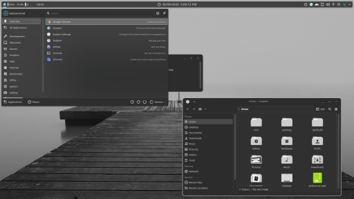

# x7dl8p

Modern minimalist soft theme for KDE Plasma 6

## Install

```bash
kpackagetool6 -t Plasma/LookAndFeel -i x7dl8p.tar.gz
```

> **Note:** This theme includes a panel layout script that sets up the desktop layout automatically.

## Preview


